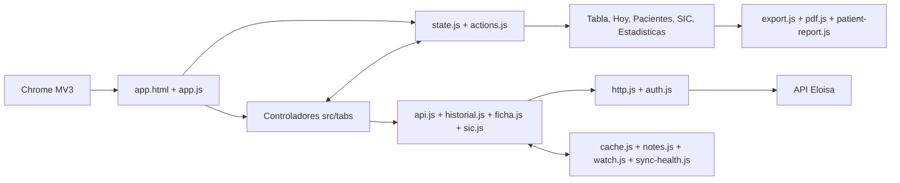

# Arquitectura de Rayen Atenciones

Este es el mapa técnico canónico de la extensión. Está escrito para que una persona o una IA pueda ubicar una responsabilidad, modificarla y validar el resultado sin reconstruir el sistema por ensayo y error.

Antes de cambiar código, lee también [`DOCUMENTATION_MAP.md`](DOCUMENTATION_MAP.md). Los endpoints y las formas observadas de la API están en [`MAPA_API.html`](MAPA_API.html).

## Límites del sistema

- Extensión Chrome Manifest V3, formada por módulos ES nativos y sin paso de compilación.
- No tiene backend propio ni dependencias de ejecución: utiliza la sesión que ya está abierta en Eloisa.
- `src/http.js` restringe todas las peticiones al origen `https://clinicohangaroa.eloisa.cl`.
- Agenda, ficha, SIC, preferencias y notas se conservan localmente en el perfil de Chrome. El token solo vive en `chrome.storage.session`.
- La aplicación completa se compone en `app.js`; `popup-init.js` solo abre la experiencia completa y `report.js` prepara el reporte imprimible.

## Vista general

## Flujos que no deben romperse

### Inicio y composición

1. `app.js` carga preferencias, configura `state.js` y registra los controladores de pestaña.
2. Cada controlador posee sus eventos y su renderizado; el orquestador no conoce el HTML interno de una pestaña.
3. `state.js` es la única fuente de verdad en memoria. Sus eventos `data` y `notes` actualizan las vistas derivadas.

### Agenda y ficha clínica

1. `loader.js` inicia, cancela o reintenta una ejecución y comunica el progreso.
2. `api.js` obtiene la agenda por fecha, usa caché incremental y vuelve a pedir fechas cuyos estados aún pueden cambiar.
3. `historial.js` consulta la ficha por día y la cruza con la agenda por RUN y fecha porque Eloisa entrega `IdCita = 0` en ese historial.
4. Una fecha solo queda completa en caché si la lectura correspondiente terminó bien. Los fallos permanecen pendientes en `sync-health.js`.
5. La interfaz distingue último intento de último éxito completo y no presenta una carga parcial como sincronizada.

### Interconsultas

1. La pestaña carga las SIC bajo demanda mediante `sic.js`.
2. `watch.js` compara una huella local para producir novedades; la primera lectura establece la referencia y no inventa cambios.
3. Si una actualización falla o es parcial, se conserva la última instantánea completa y `sync-health.js` registra el reintento necesario.

### Paciente, filtros y exportación

- `patients.js` agrega atenciones por identidad estable; `patient-panel.js` solicita y presenta el detalle longitudinal.
- Los filtros viven en los controladores de Atenciones e Interconsultas. `multi-select.js` aporta el selector accesible de selección múltiple.
- `state.rendered` conserva el mismo orden visible que utilizan navegación y exportación.
- `export.js`, `patient-report.js` y `pdf.js` generan salidas a partir de la selección actual; no escriben de vuelta en Eloisa.

## Invariantes arquitectónicos

1. `state.js` es la fuente única de datos en memoria; no se mantienen copias paralelas mutables por pestaña.
2. El caché acelera la lectura, pero una fecha con estados mutables debe volver a consultarse.
3. Agenda y ficha clínica de una fecha se consideran por separado: el éxito de una no oculta el fallo de la otra.
4. Los metadatos de sincronización contienen fechas, estados y errores técnicos, nunca nombres, RUN ni contenido clínico.
5. Ninguna petición autenticada puede salir del origen permitido por `config.js` y `http.js`.
6. Todo texto procedente de la API que entra en `innerHTML` se escapa con `esc()`.
7. La identidad y navegación de pacientes usa una clave estable; el nombre visible no es identificador.
8. Las operaciones destructivas requieren confirmación y viven en Preferencias, separadas de las acciones cotidianas.
9. Una prueba sintética no equivale a validar la extensión cargada en Chrome, y ninguna de ambas equivale a probar contra una sesión real de Eloisa.

## Dónde hacer cada cambio

| Necesidad | Punto de entrada | Validación mínima |
|---|---|---|
| Endpoint, autenticación o error HTTP | `src/http.js`, `src/auth.js`, servicio correspondiente | pruebas unitarias, guardia de origen y sesión vencida |
| Agenda, caché o actualización histórica | `src/api.js`, `src/historial.js`, `src/cache.js` | pruebas de fechas mutables, fallo parcial y reintento |
| Estado global o coordinación entre vistas | `src/state.js`, `src/actions.js` | contrato de eventos y ausencia de copias divergentes |
| Filtro o columna de Atenciones | `src/tabs/atenciones.js`, `src/table.js` | filtro, contador, limpiar/deshacer y exportación |
| Interconsultas | `src/sic.js`, `src/ic-tab.js`, `src/tabs/interconsultas.js` | carga completa/parcial, filtros y contrarreferencia |
| Vista Hoy | `src/today.js`, `src/tabs/hoy.js` | jornada vacía, antecedentes y navegación de paciente |
| Panel o reporte de paciente | `src/patient-panel.js`, `src/patient-report.js`, `src/ficha.js` | identidad, escape de texto y variantes del reporte |
| Estructura y semántica visual | `app.html` | destinos ARIA, pestañas, orden de lectura y estados vacíos |
| Sistema visual y responsive | `styles/app.css`, `src/ui.js`, `src/dom.js` | teclado, foco, modo estrecho, oscuro y movimiento reducido |
| Smoke de navegador | `dev/`, `e2e/`, `playwright.config.js` | datos sintéticos, cero red externa, escritorio y ventana estrecha |
| Release | `manifest.json`, `package.json`, `package-lock.json`, `CHANGELOG.md` | `npm run check` y `npm run pack` |

## Mapa completo de módulos

El bloque siguiente se verifica automáticamente con `npm run docs:check`. Cada módulo JavaScript de `src/` debe aparecer exactamente una vez.

<!-- module-map:start -->
- `src/actions.js` — acciones compartidas: pestañas, notas y apertura de pacientes.
- `src/ajustes.js` — preferencias, umbrales y gestión de datos locales.
- `src/api.js` — agenda por fecha, caché incremental y actualización de estados mutables.
- `src/auth.js` — recuperación segura de la sesión activa de Eloisa.
- `src/cache.js` — almacenamiento Chrome, cachés por fecha y preferencias.
- `src/charts.js` — gráficos SVG accesibles y accionables.
- `src/config.js` — origen permitido, catálogos y valores de negocio configurables.
- `src/dom.js` — utilidades DOM, escape, teclado, tooltips y esqueletos.
- `src/explorer.js` — consultas controladas del Explorador API.
- `src/export.js` — exportación filtrada a CSV, XLS, HTML, JSON y PDF.
- `src/ficha.js` — ficha longitudinal, antecedentes y programas del paciente.
- `src/historial.js` — historial diario y cruce con la agenda.
- `src/http.js` — transporte autenticado, cancelación y guardia de origen.
- `src/ic-tab.js` — presentación, filtros y orden de interconsultas.
- `src/load-summary.js` — resumen honesto y compacto del resultado de carga.
- `src/loader.js` — orquestación de carga, progreso, reintento y sesión vencida.
- `src/lock.js` — pantalla local de privacidad por inactividad.
- `src/multi-select.js` — selector múltiple accesible reutilizable.
- `src/notes.js` — identidad estable y notas locales por paciente.
- `src/palette.js` — buscador global de pacientes y ranking.
- `src/parser.js` — normalización de fechas, RUN y respuestas de Eloisa.
- `src/patient-panel.js` — interacción y renderizado del panel lateral del paciente.
- `src/patient-report.js` — modelo de historia clínica imprimible.
- `src/patients.js` — agregación pura de atenciones por paciente.
- `src/pdf.js` — obtención y presentación segura de documentos PDF.
- `src/pendientes.js` — reglas explicables de pendientes clínico-administrativos.
- `src/period.js` — periodos rápidos y rangos explícitos.
- `src/sic.js` — carga y normalización de interconsultas y contrarreferencias.
- `src/state.js` — fuente única de verdad y eventos de la aplicación.
- `src/stats.js` — cálculos puros para estadísticas.
- `src/sync-health.js` — persistencia técnica de intentos, éxitos y pendientes por fuente.
- `src/sync-status.js` — presentación de la salud de sincronización.
- `src/table.js` — columnas y renderizado de la tabla de atenciones.
- `src/tabs/atenciones.js` — controlador de filtros y tabla de Atenciones.
- `src/tabs/estadisticas.js` — controlador de la vista Estadísticas.
- `src/tabs/explorador.js` — controlador del Explorador API.
- `src/tabs/hoy.js` — controlador de fecha y jornada de Hoy.
- `src/tabs/interconsultas.js` — carga bajo demanda y eventos de SIC.
- `src/tabs/pacientes.js` — controlador de agregación, filtros y tabla de pacientes.
- `src/toast.js` — confirmaciones transitorias y acciones de deshacer.
- `src/today.js` — novedades y agenda diaria con antecedentes.
- `src/ui.js` — estado general, filtros comunes y medición del área útil.
- `src/watch.js` — memoria local de cambios en especialidades vigiladas.
<!-- module-map:end -->

## Puertas de calidad

- `npm run lint`: consistencia estática.
- `npm test`: contratos y lógica pura, sin datos reales.
- `npm run docs:check`: cobertura y enlaces del mapa arquitectónico.
- `npm run release:check`: coherencia de versiones, permisos y archivos MV3.
- `npm run check`: ejecuta todas las anteriores.
- `npm run test:e2e`: ejecuta el recorrido sintético en Chromium a 1440×900 y 582×900, sin solicitudes externas.
- `npm run pack`: vuelve a validar y genera el ZIP instalable.

El CI ejecuta `quality` y `browser-smoke` como trabajos independientes. Las pruebas reales deben registrarse por nivel: fuente local, arnés sintético, extensión cargada en Chrome y sesión autenticada de Eloisa. No se debe ascender evidencia de un nivel al siguiente.
