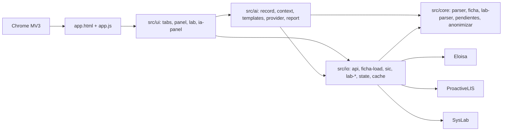

# Arquitectura de Rayen Atenciones

Este es el mapa técnico canónico de la extensión. Está escrito para que una persona o una IA pueda ubicar una responsabilidad, modificarla y validar el resultado sin reconstruir el sistema por ensayo y error.

Antes de cambiar código, lee también [`DOCUMENTATION_MAP.md`](DOCUMENTATION_MAP.md). Los endpoints y las formas observadas de la API están en [`MAPA_API.html`](MAPA_API.html).

## Límites del sistema

- Extensión Chrome Manifest V3, formada por módulos ES nativos y sin paso de compilación.
- No tiene backend propio. Las únicas dependencias de ejecución son dos librerías empaquetadas en `vendor/` (pdf.js para leer informes, pdf-lib para unirlos), cargadas bajo demanda desde `io/`. Utiliza las sesiones que el usuario ya tiene abiertas en Eloisa, en el portal del Hospital Salvador y en SysLab.
- Tres transportes, cada uno con guardia de origen: `src/io/http.js` sólo habla con `https://clinicohangaroa.eloisa.cl`; `src/io/lab-http.js` sólo con `https://examenesusuarios.hsalvador.cl`; `src/io/syslab-http.js` sólo conduce pestañas de `http://10.4.69.90` (red interna del HHR). Son exactamente los tres `host_permissions` del manifest.
- Agenda, ficha, SIC, preferencias y notas se conservan en el perfil de Chrome **cifradas** con una clave derivada de un PIN de seis dígitos (ADR 0001); la clave vive sólo en memoria de la pestaña y el bloqueo por inactividad la descarta. El token y el informe imprimible viven en `chrome.storage.session` (memoria).
- La aplicación completa se compone en `app.js`; `popup-init.js` solo abre la experiencia completa y `report.js` prepara el reporte imprimible.

## Capas

`src/` está en cuatro capas con dependencia en un solo sentido. El lint (`eslint.config.js`) lo hace cumplir y `npm run cycles:check` garantiza que no hay ciclos de importación.

| Capa | Qué contiene | Puede importar | No puede |
|---|---|---|---|
| `src/core/` | Dominio puro: análisis de Eloisa y del laboratorio, reglas clínicas, calendario, anonimizador, errores humanos | `core` | `document`, `window`, `chrome`, `fetch`, `import()` en tiempo de ejecución, `io`, `ui`, `ai` |
| `src/io/` | Eloisa, ProactiveLIS, SysLab, almacenamiento de Chrome, estado de la aplicación, pdf.js | `core`, `io` | `ui` |
| `src/ai/` | Registro clínico canónico, contexto desidentificado, plantillas, proveedores, informe | `core`, `io`, `ai` | `ui` |
| `src/ui/` | DOM: pestañas, panel del paciente, tablas, gráficos, hojas y menús | todas | — |



## Convenciones de código

1. **Un módulo, una responsabilidad.** Los controladores (`ui/tabs/*`, `ui/patient-panel.js`, `ui/tabs/laboratorio.js`) cablean eventos y reparten el pintado; no calculan. Las funciones de pintado reciben los datos por parámetro (`renderAt(cur, filtro)`), no leen variables de módulo.
2. **Tamaño.** Ninguna función supera 150 líneas útiles ni ningún módulo 500 (lint). Catálogos, arnés, pruebas y scripts están exentos.
3. **Estado.** Sólo `src/io/state.js` muta el estado global; las vistas lo cambian con sus funciones (`setData`, `setPrefs`, `setNote`, `setLoadedMonths`, `setRendered`) y se enteran por los eventos `data` y `notes`.
4. **Errores.** Los transportes lanzan clases con nombre (`AuthError`, `TimeoutError`, `CancelledError`, `LabAuthError`, `SyslabAuthError`). Lo que ve la persona pasa por `core/errors.js → humanError`. Un `catch` vacío lleva siempre un comentario con el porqué.
5. **HTML.** Todo texto de la API que entra en `innerHTML` pasa por `esc()`. Nunca `display:flex` sobre un `td`. Un solo nivel de énfasis, el contrato de tres niveles al inicio de `styles/app.css`.
6. **Idioma.** El dominio se nombra en español (ficha, atención, interconsulta, receta, pendiente, plantilla) y los verbos técnicos genéricos en inglés (`render`, `build`, `parse`, `load`, `sync`), también combinados en un mismo identificador (`renderResumen`, `syncHistorial`, `fichaStatusHtml`). Lo que no se hace es traducir el dominio al inglés (`appointment`, `prescription`). Comentarios, mensajes, pruebas y documentación en español.
7. **Pruebas.** Prueban comportamiento observable, no implementación. Cada garantía de seguridad u honestidad que la interfaz afirme tiene su prueba negativa (el token no sale del origen; el anonimizador devuelve `verificado=false` con un resto; la marca del laboratorio fuerza la alerta). Los recorridos de Playwright pulsan el elemento real que pulsa la persona, en dos anchos, sin red. Los datos sintéticos tienen la forma real: nombres de varias palabras, estados negados, fechas de Rayen.
8. **Honestidad.** Un estado vacío distingue «no hay» de «no se pudo consultar». Una carga parcial nunca se presenta como completa. Lo que la interfaz llama «comprobado» tiene detrás un ataque adversarial propio antes de escribirlo.
9. **Documentación.** Cada módulo nuevo entra en el mapa de abajo (`docs:check` lo exige y verifica que toda ruta citada exista). Cada cambio visible entra en `CHANGELOG.md` con el porqué. Los comentarios explican por qué, no qué.
10. **Entrega.** Un PR por cambio, con `npm run check` y `npx playwright test` en verde; versión en `manifest.json`, `package.json` y `package-lock.json` sincronizada (`release:check`).

## Flujos que no deben romperse

### Inicio y composición

1. `app.js` carga preferencias, configura `state.js` y registra los controladores de pestaña.
2. Cada controlador posee sus eventos y su renderizado; el orquestador no conoce el HTML interno de una pestaña.
3. `state.js` es la única fuente de verdad en memoria. Sus eventos `data` y `notes` actualizan las vistas derivadas.

### Agenda y ficha clínica

1. `ui/loader.js` inicia, cancela o reintenta una ejecución y comunica el progreso.
2. `io/api.js` obtiene la agenda por fecha en lotes (`fetchAgendaBatches`), usa caché incremental y vuelve a pedir fechas cuyos estados aún pueden cambiar; después concilia la ficha del período (`syncHistorial`).
3. `io/historial.js` consulta la ficha por día y la cruza con la agenda por RUN y fecha porque Eloisa entrega `IdCita = 0` en ese historial.
4. Una fecha solo queda completa en caché si la lectura correspondiente terminó bien. Los fallos permanecen pendientes en `io/sync-health.js`.
5. La interfaz distingue último intento de último éxito completo y no presenta una carga parcial como sincronizada.

### Panel del paciente

1. `ui/patient-panel.js → openPanel` arma `cur` (agenda del paciente, sus SIC, contacto) y pinta al instante con `ui/panel/*`.
2. `io/ficha-load.js → loadFicha` pide la ficha administrativa y luego seis fuentes en paralelo, con memoización por paciente sólo cuando todas respondieron; `core/ficha.js` las analiza. Si una falla, se dice cuál y las demás se muestran; una sesión vencida se lee del transporte y avisa como la carga principal. La fecha de cada atención es la de su cita (`FechaCita`, sólo en la consulta por paciente); la fecha de guardado (`Fecha`) se conserva como «registrada el …» cuando cae en otro día. El historial diario por nodo no trae `FechaCita`: `mergeHistorial` cruza una atención mía sin cita ese día con la cita atendida más cercana del mismo paciente (≤ 14 días antes) y le da la fecha de la cita.
3. El panel es un diálogo modal real: fondo inerte, trampa de Tab, foco devuelto a la fila. Escape cierra lo más interno: menú, hoja de informe, panel.
4. La pestaña Antecedentes (`panel/problemas.js`) es la portada: diagnósticos por peso (`core/ficha-rank.js`) y antecedentes mórbidos en una sola lista. Cada receta de una atención lleva su impresora (PDF de Eloisa).
5. En Recetas, «activa» lo afirma la lista de fármacos en uso de Rayen (`core/receta.js`, la misma lista que `RecuperarAntecedentes` y `FichaClinica/FarmacoEnUso`); una receta fuera de esa lista se clasifica por la duración escrita y la pestaña lo dice. Desplegar una receta pide su detalle a Eloisa (`io/receta.js`, `Farmacia/Receta/id=…`) y muestra vigencia, despacho y prescripciones suspendidas; no se escribe nada.

### Interconsultas y pendientes

1. La pestaña carga las SIC bajo demanda mediante `io/sic.js`; las reglas puras (`isMine`, contactos) están en `core/sic-rules.js`.
2. `io/watch.js` compara una huella local para producir novedades; la primera lectura establece la referencia y no inventa cambios.
3. `core/pendientes.js` explica cada pendiente (qué disparó, sobre qué dato, desde cuándo): SIC sin cursar, SIC rechazada, cita pasada sin resolver, control vencido.

### Exámenes complementarios

1. `io/lab-session.js` comprueba las sesiones de ProactiveLIS y SysLab sin ráfagas; `io/lab-search.js` busca en ambos con token de ejecución y cancelación.
2. `ui/tabs/laboratorio.js` orquesta; `ui/lab/results.js` pinta las órdenes; el análisis (`io/lab-report.js` → `core/lab-parser.js` → `core/lab-analytics.js`) verifica el RUN de cada PDF y arma matriz, tendencias y microbiología (`ui/lab/analysis-views.js`).
3. Los resultados del análisis vigente entran al informe con IA sólo si son del mismo RUN (`ai/lab-items.js`).

### Informe con IA y captura anonimizada

1. `ai/index.js → prepararInforme`: registro canónico (`ai/record.js`) → contexto sin identidad ni nombres de profesionales, fechas relativas, presupuesto (`ai/context.js`) → prompt con plantilla (`ai/templates.js`). Si el anonimizador detecta un resto, no hay prompt.
2. Proveedor manual: la persona copia el prompt y pega la respuesta; `parsearRespuesta` reconoce las secciones; `armarInforme` repone la identidad en local. El proveedor por API existe y viene apagado (clave y decisión institucional).
3. El Explorador API descarga una copia anonimizada de cualquier respuesta (`core/anonimizar.js`) con dos pasadas (nombres conocidos; y RUN pegado con verificador, teléfonos, fechas en texto, personas tras tratamiento o parentesco, claves por subcadena) y una comprobación final independiente. Límite conocido y declarado en la interfaz: un tercero en texto libre sin tratamiento ni parentesco delante.

### Paciente, filtros y exportación

- `ui/patients.js` agrega atenciones por identidad estable; `ui/patient-panel.js` solicita y presenta el detalle longitudinal.
- Los filtros viven en los controladores de Atenciones e Interconsultas. `ui/multi-select.js` aporta el selector accesible de selección múltiple.
- `state.rendered` conserva el mismo orden visible que utilizan navegación y exportación.
- `ui/export.js`, `ui/patient-report.js` y `io/pdf.js` generan salidas a partir de la selección actual; no escriben de vuelta en Eloisa. Exportar una tabla avisa cuántos pacientes y qué campos salen.

## Cifrado en reposo

Todo lo que se guarda pasa por `storageGet`/`storageSet` de `src/io/cache.js`; con clave en memoria (`src/io/crypto-store.js`) se cifra con AES-GCM 256 y una clave derivada del PIN (PBKDF2, 300 000 iteraciones, sal por instalación). Al arrancar, `src/ui/pin-screen.js` crea el PIN la primera vez (y cifra lo que había en claro) o lo pide; el bloqueo por inactividad descarta la clave y «Continuar» vuelve a pedirlo. Sin PIN creado (pruebas y arnés) el almacenamiento queda en claro; la aplicación real no arranca sin PIN. Olvidar el PIN equivale a «Eliminar todo». Decisión y alternativas en `docs/adr/0001-persistencia-cifrada.md`.

## Red: tiempo límite y cancelación

Cada petición a Eloisa (`src/io/http.js`) lleva un tiempo límite: `net.timeoutMs` (20 s, Preferencias → «Espera máxima por petición») para la agenda y la ficha diaria, y `net.longTimeoutMs` (60 s o el triple del anterior) para la ficha completa de un paciente, que va en una sola llamada de diez años. Sólo la carga de la agenda es cancelable: sus peticiones llevan `run.controller.signal` y `cancelRun()` las aborta en vuelo; las llamadas del panel, de interconsultas y de PDF no llevan señal y no se ven afectadas. Un día cancelado queda pendiente, no fallido. Un 401/403 marca la sesión como vencida, invalida la copia del token y recuerda el token rechazado para no volver a entregarlo aunque la pestaña de Eloisa siga mostrándolo. Errores: `AuthError`, `TimeoutError`, `CancelledError`, todos traducidos por `core/errors.js`. El plan de cada carga (fechas, refrescos, reintentos) lo calcula `src/io/sync-plan.js`, puro y con pruebas; `src/io/api.js` sólo ejecuta el plan en dos pasos, agenda y ficha, sobre un único objeto `SyncRun` documentado.

## Flujo con IA

```
datos (agenda, ficha, SIC, laboratorio, imagenología, biopsias)
  → buildClinicalRecord   registro canónico con procedencia          (ai/record.js)
  → buildContext          texto sin identidad, fechas relativas,      (ai/context.js)
                          presupuesto y comprobación de restos
  → buildPrompt           plantilla con títulos exactos               (ai/templates.js)
  → proveedor             manual (portapapeles) o API (apagada)       (ai/provider.js)
  → parsearRespuesta      secciones reconocidas, faltantes, «Sin datos»
  → armarInforme          identidad repuesta en local, pie de revisión (ai/report.js)
```

Reglas que no dependen de la plantilla: la identidad del paciente y los nombres de los profesionales nunca entran al contexto; si el anonimizador detecta un resto, `prepararInforme` falla y no hay prompt. Con la ficha caída, el contexto dice que los antecedentes no se pudieron consultar en vez de «sin datos». El proveedor por API exige clave y una decisión institucional; por eso viene apagado (el manifiesto no lo bloquea: la Messages API acepta llamadas desde el navegador con la cabecera correspondiente). Fuentes de imagenología y biopsias: contrato en `ai/sources.js`, declaradas pendientes hasta tener acceso.

## Invariantes arquitectónicos

1. `state.js` es la fuente única de datos en memoria; no se mantienen copias paralelas mutables por pestaña.
2. El caché acelera la lectura, pero una fecha con estados mutables debe volver a consultarse.
3. Agenda y ficha clínica de una fecha se consideran por separado: el éxito de una no oculta el fallo de la otra.
4. Los metadatos de sincronización contienen fechas, estados y errores técnicos, nunca nombres, RUN ni contenido clínico.
5. Ninguna petición autenticada puede salir del origen permitido por `config.js` y `http.js` (`fetch` ni siquiera se llama; hay prueba).
6. Todo texto procedente de la API que entra en `innerHTML` se escapa con `esc()`.
7. La identidad y navegación de pacientes usa una clave estable; el nombre visible no es identificador.
8. Las operaciones destructivas requieren confirmación y viven en Preferencias, separadas de las acciones cotidianas.
9. Una prueba sintética no equivale a validar la extensión cargada en Chrome, y ninguna de ambas equivale a probar contra una sesión real de Eloisa.
10. Los metadatos administrativos de Rayen no se presentan como conceptos clínicos sin una semántica validada.
11. Toda petición tiene tiempo límite y la cancelación aborta lo que está en vuelo: una red muda nunca deja la carga colgada.
12. `core` no toca el navegador; `io` y `ai` no conocen la interfaz; no hay ciclos de importación. Lo verifica cada `npm run check`.
13. La identidad del paciente nunca entra al contexto para un modelo de lenguaje; el proveedor por API viene apagado.
14. Cada garantía que la interfaz afirme («comprobado», «al día», «sin restos») tiene una prueba negativa que la defiende.

## Dónde hacer cada cambio

| Necesidad | Punto de entrada | Validación mínima |
|---|---|---|
| Endpoint, autenticación o error HTTP | `src/io/http.js`, `src/io/auth.js`, servicio correspondiente | pruebas unitarias, guardia de origen, tiempo límite, cancelación y sesión vencida |
| Agenda, caché o actualización histórica | `src/io/api.js`, `src/io/historial.js`, `src/io/cache.js` | pruebas de fechas mutables, fallo parcial y reintento |
| Estado global o coordinación entre vistas | `src/io/state.js`, `src/ui/actions.js` | contrato de eventos y ausencia de copias divergentes |
| Filtro o columna de Atenciones | `src/ui/tabs/atenciones.js`, `src/ui/table.js` | filtro, contador, limpiar/deshacer y exportación |
| Interconsultas | `src/io/sic.js`, `src/core/sic-rules.js`, `src/ui/ic-tab.js`, `src/ui/tabs/interconsultas.js` | carga completa/parcial, filtros, orden y exportación |
| Reglas de pendientes | `src/core/pendientes.js`, `src/core/config.js` | prueba por regla con el caso positivo y el negativo («sólo las mías») |
| Vista Hoy | `src/ui/today.js`, `src/ui/tabs/hoy.js`, `src/core/calendar.js` | jornada vacía, antecedentes, calendario y navegación de paciente |
| Panel del paciente | `src/ui/patient-panel.js`, `src/ui/panel/*.js`, `src/core/ficha.js`, `src/io/ficha-load.js` | identidad, escape de texto, ficha caída honesta, foco y Escape |
| Historia imprimible | `src/ui/patient-report.js`, `src/ui/export.js` | variantes del reporte y aviso de exportación |
| Laboratorio / ProactiveLIS (HSR) | `src/io/lab-http.js`, `src/io/lab-api.js`, `src/ui/tabs/laboratorio.js`, `src/ui/lab/*.js` | sesión cookie, parsing de órdenes, guardia de origen |
| Laboratorio / SysLab (HHR) | `src/io/syslab-http.js`, `src/io/syslab-api.js` | pestaña con sesión, espera de navegación, identidad del lote |
| Interpretación de informes | `src/core/lab-parser.js`, `src/core/lab-analytics.js`, `src/core/lab-catalog.js` | corpus de líneas reales anonimizadas; la marca del laboratorio fuerza la alerta |
| Informe con IA | `src/ai/*.js`, `src/ui/ia-panel.js` | contexto sin nombre ni RUN (prueba y recorrido), plantilla válida, respuesta reconocida |
| Anonimizador | `src/core/anonimizar.js`, `src/ui/tabs/explorador.js` | entradas adversariales; `verificado=false` ante un resto |
| Estructura y semántica visual | `app.html` | destinos ARIA, pestañas, orden de lectura y estados vacíos |
| Sistema visual y responsive | `styles/app.css`, `src/ui/ui.js`, `src/ui/dom.js` | teclado, foco, modo estrecho, oscuro y movimiento reducido; contraste ≥ 4,5:1 |
| Smoke de navegador | `dev/`, `e2e/`, `playwright.config.js` | datos sintéticos (agenda, SIC y ficha por paciente), `?ficha=off` para la ficha caída, capturas anonimizadas opcionales en `dev/fixtures/`, cero red externa, escritorio y ventana estrecha |
| Release | `manifest.json`, `package.json`, `package-lock.json`, `CHANGELOG.md` | `npm run check` y `npm run pack` |

## Mapa completo de módulos

El bloque siguiente se verifica automáticamente con `npm run docs:check`: cada módulo JavaScript de `src/` aparece exactamente una vez, vive en una capa, y toda ruta `src/…` citada en la documentación existe.

<!-- module-map:start -->

**Núcleo (`src/core/`) — dominio puro: sin DOM, sin red, sin Chrome. Todo lo que aquí vive se prueba con `node --test` sin arnés.**

- `src/core/anonimizar.js` — copia anonimizada de una respuesta: personas, RUT, contactos, direcciones, identificadores correlativos, fechas desplazadas; comprobación final de restos.
- `src/core/calendar.js` — rejilla mensual de atenciones para Hoy, sin DOM.
- `src/core/config.js` — origen permitido, catálogos y valores de negocio configurables.
- `src/core/errors.js` — traduce errores técnicos (red, sesión, HTTP) a frases para la persona que usa la aplicación.
- `src/core/exam-request-catalog.js` — catálogo literal del formulario de solicitud: 10 categorías, 65 exámenes y sus tubos.
- `src/core/exam-request.js` — selección, previsión y maqueta del formulario impreso de solicitud.
- `src/core/ficha-rank.js` — orden clínico sin DOM: problemas con peso (GES, crónicos, recurrentes) y vigencia de prescripciones.
- `src/core/ficha.js` — análisis de la ficha clínica (atenciones, secciones, textos libres, antecedentes, programas, maestro), sin red.
- `src/core/receta.js` — recetas sin red ni DOM: autoridad de Rayen (fármacos en uso) sobre la duración escrita, y detalle de vigencia, despacho y suspensiones.
- `src/core/lab-analytics.js` — identidad del paciente, lote íntegro, matriz comparativa y tendencias.
- `src/core/lab-catalog.js` — vocabulario clínico: orden de lectura, exclusiones, grupos, reglas de microbiología y siglas.
- `src/core/lab-microbiology.js` — categoriza cultivos, antibiogramas y PCR virales, y decide qué resultado merece destacarse.
- `src/core/lab-parser.js` — interpretación clínica del texto de un informe y detección de fuera de rango.
- `src/io/lab-pdf-text.js` — texto de un PDF con las filas reconstruidas, vía pdf.js bajo demanda.
- `src/io/lab-report.js` — informe PDF → detalle verificado por RUT, con concurrencia acotada.
- `src/core/lab-specimen.js` — clasifica la muestra biológica y decide qué entra en cada vista y en qué orden.
- `src/core/lab-summary.js` — resumen clínico de una línea con siglas, para pegar en la evolución.
- `src/core/load-summary.js` — resumen honesto y compacto del resultado de carga.
- `src/core/parser.js` — normalización de fechas, RUN y respuestas de Eloisa.
- `src/core/pendientes.js` — reglas explicables de pendientes clínico-administrativos.
- `src/core/period.js` — periodos rápidos y rangos explícitos.
- `src/core/sic-rules.js` — reglas puras de interconsultas (`isMine`, `contactsFromSICs`), sin red ni estado.
- `src/core/text.js` — `cleanText`, `nameOf` y `esc`, utilidades de texto sin DOM.

**Entrada/salida (`src/io/`) — Eloisa, SysLab, ProactiveLIS, almacenamiento de Chrome y estado de la aplicación. No conoce la interfaz.**

- `src/io/api.js` — agenda por fecha, caché incremental y actualización de estados mutables.
- `src/io/auth.js` — recuperación segura de la sesión activa de Eloisa.
- `src/io/cache.js` — almacenamiento Chrome, cachés por fecha y preferencias.
- `src/io/crypto-store.js` — cifrado en reposo (ADR 0001): AES-GCM con clave derivada del PIN por PBKDF2, creación y cambio de PIN, migración de lo que estaba en claro; la clave sólo en memoria.
- `src/io/explorer.js` — consultas controladas del Explorador API.
- `src/io/ficha-load.js` — carga de la ficha desde Eloisa: seis fuentes en paralelo, memoización y respuestas crudas para el Explorador.
- `src/io/historial.js` — historial diario y cruce con la agenda.
- `src/io/http.js` — transporte autenticado, cancelación y guardia de origen.
- `src/io/lab-api.js` — servicio ProactiveLIS: búsqueda de órdenes, PDF e informes.
- `src/io/lab-http.js` — transporte cookie-based para el origen examenesusuarios.hsalvador.cl.
- `src/io/lab-search.js` — búsqueda en los dos laboratorios sin DOM: RUT buscado, token de ejecución, cancelación, filtro de período y resultados por callbacks.
- `src/io/lab-session.js` — estado de sesión de los laboratorios sin DOM: qué se muestra por cada resultado y ventana de caché de la comprobación.
- `src/io/notes.js` — identidad estable y notas locales por paciente.
- `src/io/pdf.js` — obtención y presentación segura de documentos PDF.
- `src/io/receta.js` — detalle de una receta desde Eloisa, bajo demanda y una vez por receta; recargar la ficha vacía la memoria.
- `src/io/sic.js` — carga y normalización de interconsultas.
- `src/io/state.js` — fuente única de verdad y eventos de la aplicación.
- `src/io/sync-plan.js` — plan puro de una carga: fechas del período, refrescos por estado mutable, reintentos y historial acoplado (`SyncPlan`).
- `src/io/sync-health.js` — persistencia técnica de intentos, éxitos y pendientes por fuente.
- `src/io/syslab-api.js` — servicio SysLab HHR: búsqueda por RUT y verificación de identidad del lote.
- `src/io/syslab-http.js` — conducción de la pestaña SysLab (navegación por estado) y lectura de su DOM.
- `src/io/watch.js` — memoria local de cambios en especialidades vigiladas.

**Interfaz (`src/ui/`) — DOM, pestañas, panel del paciente, gráficos e informes en HTML.**

- `src/ui/actions.js` — acciones compartidas: pestañas, notas y apertura de pacientes.
- `src/ui/ajustes.js` — preferencias, umbrales y gestión de datos locales.
- `src/ui/charts.js` — gráficos SVG accesibles y accionables.
- `src/ui/dom.js` — utilidades DOM, escape, teclado, tooltips y esqueletos.
- `src/ui/exam-request-view.js` — dibujo del formulario de solicitud, en pantalla y para imprimir.
- `src/ui/export.js` — exportación filtrada a CSV, XLS, HTML, JSON y PDF.
- `src/ui/ia-panel.js` — hoja «Informe con IA» del panel: plantilla, ventana, fuentes, contexto visible, copiar prompt, pegar respuesta, informe e impresión (proveedor manual).
- `src/ui/ic-tab.js` — presentación, filtros y orden de interconsultas.
- `src/ui/lab-charts.js` — series de tendencia en SVG, con las alteraciones destacadas.
- `src/ui/lab-trends.js` — agrupa las series en tarjetas clínicas y las filtra por período, texto y alteración.
- `src/ui/loader.js` — orquestación de carga, progreso, reintento y sesión vencida.
- `src/ui/lock.js` — pantalla local de privacidad por inactividad.
- `src/ui/multi-select.js` — selector múltiple accesible reutilizable.
- `src/ui/pin-screen.js` — pantalla de PIN al arrancar (crear o pedir) y tras el bloqueo por inactividad.
- `src/ui/palette.js` — buscador global de pacientes y ranking.
- `src/ui/patient-panel.js` — controlador del panel del paciente: paciente abierto y filtros, diálogo modal, cableado y reparto del pintado entre `panel/`.
- `src/ui/panel/helpers.js` — piezas de HTML y DOM que comparten las pestañas del panel (`kv`, `h4`, `segGroup`, `setTabCount`, `isMineVisit`).
- `src/ui/panel/datos.js` — cabecera del panel y datos administrativos.
- `src/ui/panel/problemas.js` — pestaña Antecedentes: diagnósticos con peso y antecedentes mórbidos en una sola lista, alergias y programas.
- `src/ui/panel/atenciones.js` — pestaña Atenciones: tarjetas de la ficha (Medicina / Otros) o agenda.
- `src/ui/panel/interconsultas.js` — pestaña Interconsultas (Mías / De otros) y derivaciones.
- `src/ui/panel/recetas.js` — pestaña Recetas: activas según Rayen (duración escrita de respaldo) y detalle de despacho al desplegar.
- `src/ui/panel/notas.js` — diario de notas del paciente y su cableado.
- `src/ui/panel/pdf-menu.js` — menú «PDF ▾» de la historia del paciente.
- `src/ui/panel/ficha-status.js` — estado de la ficha dentro de Datos (avatar), con su tono en el avatar.
- `src/ui/patient-report.js` — modelo de historia clínica imprimible.
- `src/ui/patients.js` — agregación pura de atenciones por paciente.
- `src/ui/pdf-merge.js` — fusión de informes en un PDF único, con pdf-lib cargado bajo demanda.
- `src/ui/stats.js` — cálculos puros para estadísticas.
- `src/ui/sync-status.js` — presentación de la salud de sincronización.
- `src/ui/table.js` — columnas y renderizado de la tabla de atenciones.
- `src/ui/tabs/atenciones.js` — controlador de filtros y tabla de Atenciones.
- `src/ui/tabs/estadisticas.js` — controlador de la vista Estadísticas.
- `src/ui/tabs/explorador.js` — controlador del Explorador API: consultas, capturas de la sesión (ficha del último paciente, citas) y descarga de la copia anonimizada.
- `src/ui/tabs/hoy.js` — controlador de fecha y jornada de Hoy.
- `src/ui/tabs/interconsultas.js` — carga bajo demanda y eventos de SIC.
- `src/ui/tabs/laboratorio.js` — controlador de la pestaña Exámenes complementarios: sesiones, búsqueda, selección y orquestación del análisis; lo demás en `ui/lab/`.
- `src/ui/lab/results.js` — tablas de órdenes HSR y HHR con PDF y casilla de selección.
- `src/ui/lab/analysis-views.js` — vistas del análisis: matriz de comparación, informes, tendencias y microbiología.
- `src/ui/lab/request.js` — solicitud de exámenes: formulario de casillas que se imprime.
- `src/ui/lab/pdf-all.js` — «Todos los PDF»: un archivo con los informes imprimibles de ambos hospitales.
- `src/ui/tabs/pacientes.js` — controlador de agregación, filtros y tabla de pacientes.
- `src/ui/toast.js` — confirmaciones transitorias y acciones de deshacer.
- `src/ui/today.js` — novedades y agenda diaria con antecedentes.
- `src/ui/ui.js` — estado general, filtros comunes y medición del área útil.

**Inteligencia artificial (`src/ai/`) — flujos con modelos de lenguaje, sin interfaz. Depende de `core` e `io`.**

- `src/ai/record.js` — registro clínico canónico: agenda, ficha, interconsultas, laboratorio, imagenología y biopsias con procedencia por fuente; la única forma de datos que ven los flujos con IA.
- `src/ai/sources.js` — registro de fuentes de exámenes complementarios (contrato `obtener()`), con imagenología y biopsias declaradas como pendientes.
- `src/ai/context.js` — contexto desidentificado para el modelo: sin nombres ni RUN, fechas relativas, presupuesto de tamaño y comprobación final de restos.
- `src/ai/templates.js` — plantillas de informe declarativas (predeterminadas y personalizadas), validación y prompt con estructura obligatoria.
- `src/ai/provider.js` — proveedores: manual (copiar prompt, pegar respuesta; sin red) y API de Anthropic (Messages API por HTTP, apagado sin clave); reconocimiento de la respuesta por secciones.
- `src/ai/report.js` — informe final con la identidad repuesta en local, secciones faltantes marcadas, pie de revisión y Markdown → HTML mínimo.
- `src/ai/lab-items.js` — del modelo analítico de laboratorio a los ítems del registro clínico, sólo si son del mismo RUN.
- `src/ai/index.js` — ciclo completo: `prepararInforme` (registro → contexto → prompt) y `cerrarInforme` (respuesta → informe).

<!-- module-map:end -->

## Puertas de calidad

- `npm run lint`: consistencia estática, vallas entre capas, tamaño de funciones y módulos.
- `npm test`: contratos y lógica pura, sin datos reales; incluye las pruebas negativas de las garantías.
- `npm run cycles:check`: sin ciclos de importación en `src/`.
- `npm run docs:check`: cobertura del mapa arquitectónico, capa de cada módulo y rutas citadas.
- `npm run release:check`: coherencia de versiones, permisos y archivos MV3.
- `npm run check`: ejecuta todas las anteriores.
- `npm run test:e2e`: recorridos sintéticos en Chromium a 1440×900 y 582×900, sin solicitudes externas: carga y filtros, teclado, panel con ficha sintética y con ficha caída, informe con IA, captura anonimizada, laboratorio, bloqueo y flujos (Lab, Escape, chip «+n», Detalle, flechas). El arnés (`dev/chrome-stub.js`) enruta los siete endpoints de la ficha a `dev/ficha-fixture.js`, o a capturas anonimizadas reales importadas con `scripts/import-capture.mjs`.
- `npm run pack`: vuelve a validar y genera el ZIP instalable.

El CI ejecuta `quality` y `browser-smoke` como trabajos independientes. Las pruebas reales deben registrarse por nivel: fuente local, arnés sintético, extensión cargada en Chrome y sesión autenticada de Eloisa. No se debe ascender evidencia de un nivel al siguiente.
