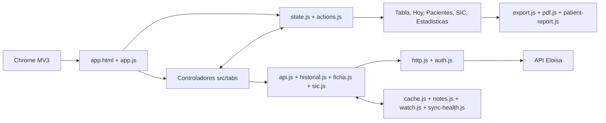

# Arquitectura de Rayen Atenciones

Este es el mapa técnico canónico de la extensión. Está escrito para que una persona o una IA pueda ubicar una responsabilidad, modificarla y validar el resultado sin reconstruir el sistema por ensayo y error.

Antes de cambiar código, lee también [`DOCUMENTATION_MAP.md`](DOCUMENTATION_MAP.md). Los endpoints y las formas observadas de la API están en [`MAPA_API.html`](MAPA_API.html).

## Límites del sistema

- Extensión Chrome Manifest V3, formada por módulos ES nativos y sin paso de compilación.
- No tiene backend propio. Las únicas dependencias de ejecución son dos librerías empaquetadas en `vendor/` (pdf.js para leer informes, pdf-lib para unirlos), cargadas bajo demanda. Utiliza las sesiones que el usuario ya tiene abiertas en Eloisa, en el portal del Hospital Salvador y en SysLab.
- Tres transportes, cada uno con guardia de origen: `src/io/http.js` sólo habla con `https://clinicohangaroa.eloisa.cl`; `src/io/lab-http.js` sólo con `https://examenesusuarios.hsalvador.cl`; `src/io/syslab-http.js` sólo conduce pestañas de `http://10.4.69.90` (red interna del HHR). Son exactamente los tres `host_permissions` del manifest.
- Agenda, ficha, SIC, preferencias y notas se conservan localmente en el perfil de Chrome. El token solo vive en `chrome.storage.session`.
- La aplicación completa se compone en `app.js`; `popup-init.js` solo abre la experiencia completa y `report.js` prepara el reporte imprimible.

## Vista general



## Flujos que no deben romperse

### Inicio y composición

1. `app.js` carga preferencias, configura `state.js` y registra los controladores de pestaña.
2. Cada controlador posee sus eventos y su renderizado; el orquestador no conoce el HTML interno de una pestaña.
3. `state.js` es la única fuente de verdad en memoria. Sus eventos `data` y `notes` actualizan las vistas derivadas.

### Agenda y ficha clínica

1. `loader.js` inicia, cancela o reintenta una ejecución y comunica el progreso.
2. `api.js` obtiene la agenda por fecha, usa caché incremental y vuelve a pedir fechas cuyos estados aún pueden cambiar.
3. `historial.js` consulta la ficha por día y la cruza con la agenda por RUN y fecha porque Eloisa entrega `IdCita = 0` en ese historial.
4. Una fecha solo queda completa en caché si la lectura correspondiente terminó bien. Los fallos permanecen pendientes en `sync-health.js`.
5. La interfaz distingue último intento de último éxito completo y no presenta una carga parcial como sincronizada.

### Interconsultas

1. La pestaña carga las SIC bajo demanda mediante `sic.js`.
2. `watch.js` compara una huella local para producir novedades; la primera lectura establece la referencia y no inventa cambios.
3. Si una actualización falla o es parcial, se conserva la última instantánea completa y `sync-health.js` registra el reintento necesario.

### Paciente, filtros y exportación

- `patients.js` agrega atenciones por identidad estable; `patient-panel.js` solicita y presenta el detalle longitudinal.
- Los filtros viven en los controladores de Atenciones e Interconsultas. `multi-select.js` aporta el selector accesible de selección múltiple.
- `state.rendered` conserva el mismo orden visible que utilizan navegación y exportación.
- `export.js`, `patient-report.js` y `pdf.js` generan salidas a partir de la selección actual; no escriben de vuelta en Eloisa.

## Invariantes arquitectónicos

1. `state.js` es la fuente única de datos en memoria; no se mantienen copias paralelas mutables por pestaña.
2. El caché acelera la lectura, pero una fecha con estados mutables debe volver a consultarse.
3. Agenda y ficha clínica de una fecha se consideran por separado: el éxito de una no oculta el fallo de la otra.
4. Los metadatos de sincronización contienen fechas, estados y errores técnicos, nunca nombres, RUN ni contenido clínico.
5. Ninguna petición autenticada puede salir del origen permitido por `config.js` y `http.js`.
6. Todo texto procedente de la API que entra en `innerHTML` se escapa con `esc()`.
7. La identidad y navegación de pacientes usa una clave estable; el nombre visible no es identificador.
8. Las operaciones destructivas requieren confirmación y viven en Preferencias, separadas de las acciones cotidianas.
9. Una prueba sintética no equivale a validar la extensión cargada en Chrome, y ninguna de ambas equivale a probar contra una sesión real de Eloisa.
10. Los metadatos administrativos de Rayen no se presentan como conceptos clínicos sin una semántica validada.

## Dónde hacer cada cambio

| Necesidad | Punto de entrada | Validación mínima |
|---|---|---|
| Endpoint, autenticación o error HTTP | `src/io/http.js`, `src/io/auth.js`, servicio correspondiente | pruebas unitarias, guardia de origen y sesión vencida |
| Agenda, caché o actualización histórica | `src/io/api.js`, `src/io/historial.js`, `src/io/cache.js` | pruebas de fechas mutables, fallo parcial y reintento |
| Estado global o coordinación entre vistas | `src/io/state.js`, `src/ui/actions.js` | contrato de eventos y ausencia de copias divergentes |
| Filtro o columna de Atenciones | `src/ui/tabs/atenciones.js`, `src/ui/table.js` | filtro, contador, limpiar/deshacer y exportación |
| Interconsultas | `src/io/sic.js`, `src/ui/ic-tab.js`, `src/ui/tabs/interconsultas.js` | carga completa/parcial, filtros, orden y exportación |
| Vista Hoy | `src/ui/today.js`, `src/ui/tabs/hoy.js` | jornada vacía, antecedentes y navegación de paciente |
| Panel o reporte de paciente | `src/ui/patient-panel.js`, `src/ui/patient-report.js`, `src/core/ficha.js` | identidad, escape de texto y variantes del reporte |
| Laboratorio / ProactiveLIS (HSR) | `src/io/lab-http.js`, `src/io/lab-api.js`, `src/ui/tabs/laboratorio.js` | sesión cookie, parsing de órdenes, guardia de origen |
| Laboratorio / SysLab (HHR) | `src/io/syslab-http.js`, `src/io/syslab-api.js`, `src/ui/tabs/laboratorio.js` | pestaña con sesión, espera de navegación, identidad del lote |
| Estructura y semántica visual | `app.html` | destinos ARIA, pestañas, orden de lectura y estados vacíos |
| Sistema visual y responsive | `styles/app.css`, `src/ui/ui.js`, `src/ui/dom.js` | teclado, foco, modo estrecho, oscuro y movimiento reducido |
| Smoke de navegador | `dev/`, `e2e/`, `playwright.config.js` | datos sintéticos, cero red externa, escritorio y ventana estrecha |
| Release | `manifest.json`, `package.json`, `package-lock.json`, `CHANGELOG.md` | `npm run check` y `npm run pack` |

## Mapa completo de módulos

El bloque siguiente se verifica automáticamente con `npm run docs:check`. Cada módulo JavaScript de `src/` debe aparecer exactamente una vez.

## Capas

El código de `src/` está en tres capas con dependencia en un solo sentido: `ui` → `io` → `core`. El lint (`eslint.config.js`) lo hace cumplir: `core` no puede usar `document`, `window`, `chrome` ni `fetch`, ni importar de `io`/`ui`; `io` no importa de `ui`. La cuarta capa, `src/ai/`, contiene los flujos con modelos de lenguaje; depende de `core` e `io`, nunca de `ui`.

## Red: tiempo límite y cancelación

Cada petición a Eloisa (`src/io/http.js`) lleva `AbortSignal.timeout(CONFIG.httpTimeoutMs)` y la señal de la carga en curso: `cancelRun()` aborta lo que está en vuelo y los cargadores no encolan más lotes. Un 401/403 marca la sesión como vencida e invalida la copia del token en `storage.session`. Errores: `AuthError`, `TimeoutError`, `CancelledError`, todos traducidos por `core/errors.js`.

## Flujo con IA

```
datos (agenda, ficha, SIC, laboratorio, imagenología, biopsias)
  → buildClinicalRecord   registro canónico con procedencia          (ai/record.js)
  → buildContext          texto sin identidad, fechas relativas,      (ai/context.js)
                          presupuesto y comprobación de restos
  → buildPrompt           plantilla con títulos exactos               (ai/templates.js)
  → proveedor             manual (portapapeles) o API (apagada)       (ai/provider.js)
  → parsearRespuesta      secciones reconocidas, faltantes, «Sin datos»
  → armarInforme          identidad repuesta en local, pie de revisión (ai/report.js)
```

Reglas que no dependen de la plantilla: la identidad del paciente y los nombres de los profesionales nunca entran al contexto; si el anonimizador detecta un resto, `prepararInforme` falla y no hay prompt. El proveedor por API exige clave y una decisión institucional; por eso viene apagado (el manifiesto no lo bloquea: la Messages API acepta llamadas desde el navegador con la cabecera correspondiente).

<!-- module-map:start -->

**Núcleo (`src/core/`) — dominio puro: sin DOM, sin red, sin Chrome. Todo lo que aquí vive se prueba con `node --test` sin arnés.**

- `src/core/anonimizar.js` — copia anonimizada de una respuesta: personas, RUT, contactos, direcciones, identificadores correlativos, fechas desplazadas; comprobación final de restos.
- `src/core/calendar.js` — rejilla mensual de atenciones para Hoy, sin DOM.
- `src/core/config.js` — origen permitido, catálogos y valores de negocio configurables.
- `src/core/errors.js` — traduce errores técnicos (red, sesión, HTTP) a frases para la persona que usa la aplicación.
- `src/core/exam-request-catalog.js` — catálogo literal del formulario de solicitud: 10 categorías, 65 exámenes y sus tubos.
- `src/core/exam-request.js` — selección, previsión y maqueta del formulario impreso de solicitud.
- `src/core/ficha-rank.js` — orden clínico sin DOM: problemas con peso (GES, crónicos, recurrentes) y vigencia de prescripciones.
- `src/core/ficha.js` — análisis de la ficha clínica (atenciones, secciones, textos libres, antecedentes, programas, maestro), sin red.
- `src/core/lab-analytics.js` — identidad del paciente, lote íntegro, matriz comparativa y tendencias.
- `src/core/lab-catalog.js` — vocabulario clínico: orden de lectura, exclusiones, grupos, reglas de microbiología y siglas.
- `src/core/lab-microbiology.js` — categoriza cultivos, antibiogramas y PCR virales, y decide qué resultado merece destacarse.
- `src/core/lab-parser.js` — interpretación clínica del texto de un informe y detección de fuera de rango.
- `src/io/lab-pdf-text.js` — texto de un PDF con las filas reconstruidas, vía pdf.js bajo demanda.
- `src/io/lab-report.js` — informe PDF → detalle verificado por RUT, con concurrencia acotada.
- `src/core/lab-specimen.js` — clasifica la muestra biológica y decide qué entra en cada vista y en qué orden.
- `src/core/lab-summary.js` — resumen clínico de una línea con siglas, para pegar en la evolución.
- `src/core/load-summary.js` — resumen honesto y compacto del resultado de carga.
- `src/core/parser.js` — normalización de fechas, RUN y respuestas de Eloisa.
- `src/core/pendientes.js` — reglas explicables de pendientes clínico-administrativos.
- `src/core/period.js` — periodos rápidos y rangos explícitos.
- `src/core/sic-rules.js` — reglas puras de interconsultas (`isMine`, `contactsFromSICs`), sin red ni estado.
- `src/core/text.js` — `cleanText`, `nameOf` y `esc`, utilidades de texto sin DOM.

**Entrada/salida (`src/io/`) — Eloisa, SysLab, ProactiveLIS, almacenamiento de Chrome y estado de la aplicación. No conoce la interfaz.**

- `src/io/api.js` — agenda por fecha, caché incremental y actualización de estados mutables.
- `src/io/auth.js` — recuperación segura de la sesión activa de Eloisa.
- `src/io/cache.js` — almacenamiento Chrome, cachés por fecha y preferencias.
- `src/io/explorer.js` — consultas controladas del Explorador API.
- `src/io/ficha-load.js` — carga de la ficha desde Eloisa: seis fuentes en paralelo, memoización y respuestas crudas para el Explorador.
- `src/io/historial.js` — historial diario y cruce con la agenda.
- `src/io/http.js` — transporte autenticado, cancelación y guardia de origen.
- `src/io/lab-api.js` — servicio ProactiveLIS: búsqueda de órdenes, PDF e informes.
- `src/io/lab-http.js` — transporte cookie-based para el origen examenesusuarios.hsalvador.cl.
- `src/io/lab-search.js` — búsqueda en los dos laboratorios sin DOM: RUT buscado, token de ejecución, cancelación, filtro de período y resultados por callbacks.
- `src/io/lab-session.js` — estado de sesión de los laboratorios sin DOM: qué se muestra por cada resultado y ventana de caché de la comprobación.
- `src/io/notes.js` — identidad estable y notas locales por paciente.
- `src/io/pdf.js` — obtención y presentación segura de documentos PDF.
- `src/io/sic.js` — carga y normalización de interconsultas.
- `src/io/state.js` — fuente única de verdad y eventos de la aplicación.
- `src/io/sync-health.js` — persistencia técnica de intentos, éxitos y pendientes por fuente.
- `src/io/syslab-api.js` — servicio SysLab HHR: búsqueda por RUT y verificación de identidad del lote.
- `src/io/syslab-http.js` — conducción de la pestaña SysLab (navegación por estado) y lectura de su DOM.
- `src/io/watch.js` — memoria local de cambios en especialidades vigiladas.

**Interfaz (`src/ui/`) — DOM, pestañas, panel del paciente, gráficos e informes en HTML.**

- `src/ui/actions.js` — acciones compartidas: pestañas, notas y apertura de pacientes.
- `src/ui/ajustes.js` — preferencias, umbrales y gestión de datos locales.
- `src/ui/charts.js` — gráficos SVG accesibles y accionables.
- `src/ui/dom.js` — utilidades DOM, escape, teclado, tooltips y esqueletos.
- `src/ui/exam-request-view.js` — dibujo del formulario de solicitud, en pantalla y para imprimir.
- `src/ui/export.js` — exportación filtrada a CSV, XLS, HTML, JSON y PDF.
- `src/ui/ia-panel.js` — hoja «Informe con IA» del panel: plantilla, ventana, fuentes, contexto visible, copiar prompt, pegar respuesta, informe e impresión (proveedor manual).
- `src/ui/ic-tab.js` — presentación, filtros y orden de interconsultas.
- `src/ui/lab-charts.js` — series de tendencia en SVG, con las alteraciones destacadas.
- `src/ui/lab-trends.js` — agrupa las series en tarjetas clínicas y las filtra por período, texto y alteración.
- `src/ui/loader.js` — orquestación de carga, progreso, reintento y sesión vencida.
- `src/ui/lock.js` — pantalla local de privacidad por inactividad.
- `src/ui/multi-select.js` — selector múltiple accesible reutilizable.
- `src/ui/palette.js` — buscador global de pacientes y ranking.
- `src/ui/patient-panel.js` — interacción y renderizado del panel lateral del paciente.
- `src/ui/patient-report.js` — modelo de historia clínica imprimible.
- `src/ui/patients.js` — agregación pura de atenciones por paciente.
- `src/ui/pdf-merge.js` — fusión de informes en un PDF único, con pdf-lib cargado bajo demanda.
- `src/ui/stats.js` — cálculos puros para estadísticas.
- `src/ui/sync-status.js` — presentación de la salud de sincronización.
- `src/ui/table.js` — columnas y renderizado de la tabla de atenciones.
- `src/ui/tabs/atenciones.js` — controlador de filtros y tabla de Atenciones.
- `src/ui/tabs/estadisticas.js` — controlador de la vista Estadísticas.
- `src/ui/tabs/explorador.js` — controlador del Explorador API: consultas, capturas de la sesión (ficha del último paciente, citas) y descarga de la copia anonimizada.
- `src/ui/tabs/hoy.js` — controlador de fecha y jornada de Hoy.
- `src/ui/tabs/interconsultas.js` — carga bajo demanda y eventos de SIC.
- `src/ui/tabs/laboratorio.js` — controlador de la pestaña Laboratorio: Hospital Salvador (ProactiveLIS) y HHR (SysLab), análisis y solicitud de exámenes.
- `src/ui/tabs/pacientes.js` — controlador de agregación, filtros y tabla de pacientes.
- `src/ui/toast.js` — confirmaciones transitorias y acciones de deshacer.
- `src/ui/today.js` — novedades y agenda diaria con antecedentes.
- `src/ui/ui.js` — estado general, filtros comunes y medición del área útil.

**Inteligencia artificial (`src/ai/`) — flujos con modelos de lenguaje, sin interfaz. Depende de `core` e `io`.**

- `src/ai/record.js` — registro clínico canónico: agenda, ficha, interconsultas, laboratorio, imagenología y biopsias con procedencia por fuente; la única forma de datos que ven los flujos con IA.
- `src/ai/sources.js` — registro de fuentes de exámenes complementarios (contrato `obtener()`), con imagenología y biopsias declaradas como pendientes.
- `src/ai/context.js` — contexto desidentificado para el modelo: sin nombres ni RUN, fechas relativas, presupuesto de tamaño y comprobación final de restos.
- `src/ai/templates.js` — plantillas de informe declarativas (predeterminadas y personalizadas), validación y prompt con estructura obligatoria.
- `src/ai/provider.js` — proveedores: manual (copiar prompt, pegar respuesta; sin red) y API de Anthropic (Messages API por HTTP, apagado sin clave); reconocimiento de la respuesta por secciones.
- `src/ai/report.js` — informe final con la identidad repuesta en local, secciones faltantes marcadas, pie de revisión y Markdown → HTML mínimo.
- `src/ai/index.js` — ciclo completo: `prepararInforme` (registro → contexto → prompt) y `cerrarInforme` (respuesta → informe).

<!-- module-map:end -->

## Puertas de calidad

- `npm run lint`: consistencia estática.
- `npm test`: contratos y lógica pura, sin datos reales.
- `npm run docs:check`: cobertura y enlaces del mapa arquitectónico.
- `npm run release:check`: coherencia de versiones, permisos y archivos MV3.
- `npm run check`: ejecuta todas las anteriores.
- `npm run test:e2e`: ejecuta el recorrido sintético en Chromium a 1440×900 y 582×900, sin solicitudes externas.
- `npm run pack`: vuelve a validar y genera el ZIP instalable.

El CI ejecuta `quality` y `browser-smoke` como trabajos independientes. Las pruebas reales deben registrarse por nivel: fuente local, arnés sintético, extensión cargada en Chrome y sesión autenticada de Eloisa. No se debe ascender evidencia de un nivel al siguiente.
